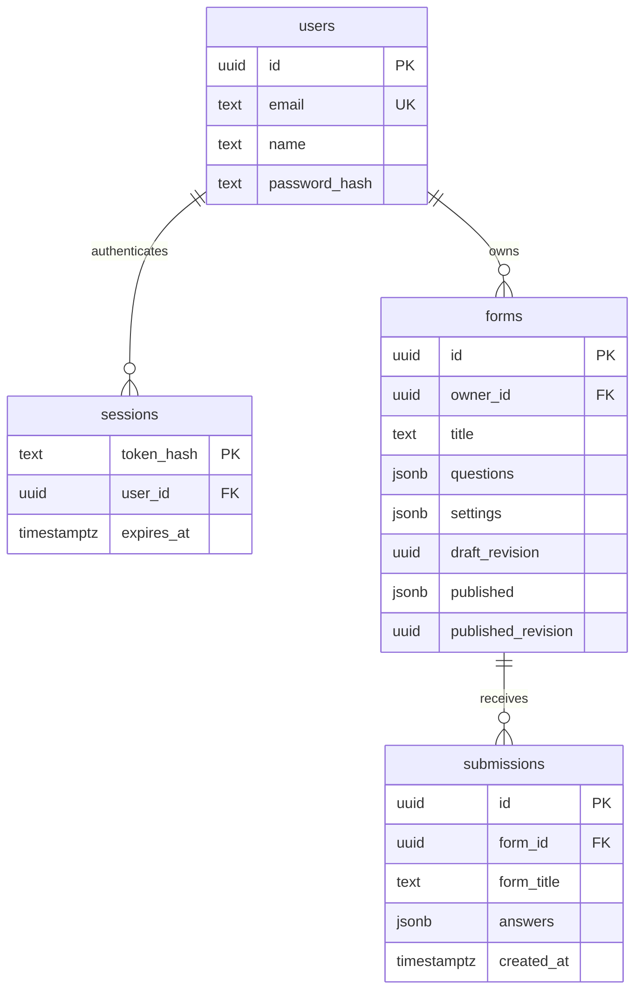

# Architecture and decisions

## One application, two audiences

Creators use authenticated server-rendered dashboard routes and a React form builder. Respondents use a public form page or an iframe containing the same `ChatForm` component. Sharing that component keeps validation, answer buttons and completion behavior consistent across preview, public links and embedding.

The App Router API handler delegates persistence to `lib/forms.ts`, session handling to `lib/auth.ts`, schema validation to `lib/validation.ts` and storage to `lib/db.ts`. SQL remains parameterized, and all owner reads/writes scope to both form ID and authenticated user ID.

## Database model

JSONB keeps the small, ordered question definition together and makes publication snapshots straightforward. A normalized question table would become useful for large-scale cross-form analytics; it adds unnecessary joins and synchronization work for this MVP.

## Drafts and publication are separate

A save modifies the editable definition and replaces `draft_revision`. A publish validates the complete saved draft and copies it into `published`, with a new `published_revision`. Public routes read only the published snapshot.

Writes use an expected draft revision to reject stale tabs. Submissions carry the public revision they answered; a changed revision is rejected with HTTP 409. The insert checks the active revision again in SQL, closing the gap between reading the definition and saving an answer.

Unpublish clears the public snapshot and revision. Historical submissions remain. Each submission stores its original form title, question labels, question types and answers, so editing a form never changes the meaning of an old response.

## Reliable submission retries

The browser generates a submission UUID for a conversation. Retrying the same response returns success without inserting another row. Reusing that UUID with different answers is rejected. The completion message appears only after the server confirms a successful submission; preview mode is visibly labeled and never calls the submission endpoint.

## Embedding and browser isolation

The plain JavaScript loader finds its application origin from its own script URL. It creates a Shadow DOM container for the floating button/panel and lazy-loads `/embed/<form-id>` in an iframe when opened. Host-page CSS therefore does not alter the widget UI.

The iframe submits to its own application origin; it does not need cross-origin owner cookies or broad write CORS. Public metadata has read-only CORS so the launcher can adopt the published accent color. Close messages are accepted only when both `event.origin` and `event.source` match the expected iframe.

The independent `examples/embed-host` project demonstrates a different domain and framework-free HTML. The loader prevents duplicate installation of the same form widget and adapts to narrow screens.

## Local and production storage

Production uses a separate Neon PostgreSQL database. The adapter also accepts ordinary PostgreSQL and Supabase pooled PostgreSQL URLs. `postgres.js` uses a small pool and disables prepared statements for pooler compatibility.

Local development falls back to PGlite on persistent disk. Its SQL engine is PostgreSQL compiled to WebAssembly. This allows a reviewer to run the entire app without provisioned services while keeping PostgreSQL's JSONB behavior, constraints and timestamps. Serverless environments require a remote database explicitly.

Initial schema creation is idempotent and serialized with a transaction-scoped advisory lock for concurrent serverless starts. A mature product should replace first-run DDL with versioned deployment migrations and separate runtime/migration database roles.

## Authentication and scope decisions

The MVP implements email/password signup and login to make ownership verifiable with two independent accounts. It uses asynchronous scrypt hashes and opaque sessions rather than browser-stored identity claims. Authentication and submission attempts have database-backed limits.

Password reset, email verification, CAPTCHA, granular team roles and commercial authentication providers are beyond the requested scope. They are documented as follow-up work rather than represented by nonfunctional buttons.
